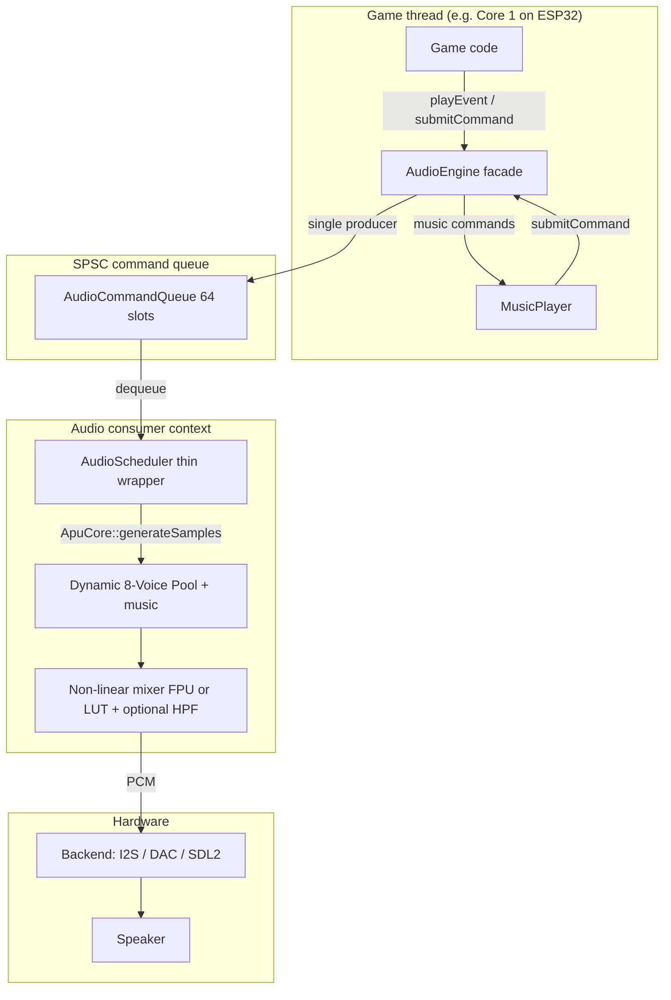

# Audio System

PixelRoot32 provides a **NES-like** audio subsystem: a **dynamic 8-voice pooling system** (supporting Pulse, Triangle, Noise, Sine, and Saw waveforms), **mono** 16-bit output, **event-driven** playback (`AudioEvent`), and **sample-accurate** timing decoupled from the game frame rate. There is **no DMC/sample channel** in the current engine.

For implementation details, see [Audio subsystem](../architecture/audio-subsystem.md) (authoritative).

## Architecture Overview



- **`AudioEngine`** forwards commands and **`generateSamples`** to the active **`AudioScheduler`**, which delegates to **`ApuCore`**: SPSC queue, dynamic 8-voice pool, music sequencer, mixing, and (on the FPU path) a one-pole output HPF. Synthesis is not duplicated across three scheduler copies.
- On **ESP32**, core affinity and task priority are applied when the **backend** creates its FreeRTOS task (`PlatformCapabilities`), not inside `ESP32AudioScheduler` construction arguments (those parameters are reserved for API stability).

## Key Features

| Feature | Description |
|--------|-------------|
| **8 voices** | Dynamic voice pooling with stealing logic. Supports Pulse, Triangle, Noise, Sine, and Saw. |
| **Sample-accurate** | Channel lifetime in samples; independent of FPS |
| **Schedulers** | `NativeAudioScheduler` (PC), `ESP32AudioScheduler` (firmware), `DefaultAudioScheduler` (tests / callback-driven) |
| **Command path** | Lock-free **SPSC** ring buffer, **64** entries (32–64; one slot stays free, so 63 commands); one producer / one consumer |
| **Mixer** | Soft saturation (FPU) or **LUT** (no-FPU, e.g. ESP32-C3) |
| **Multi-track music** | Up to **`MAX_MUSIC_TRACKS` (4)**: main `MusicTrack` + optional **`secondVoice`**, **`thirdVoice`**, **`percussion`**; `MusicPlayer::play` packs them into **`AudioCommand::subTracks`** |
| **NES-style timing** | Sequencer in **`ApuCore`** uses **tick** steps derived from **sample time** and **BPM** (default **150** BPM, **4 ticks per beat**); not tied to render FPS |
| **BPM & tempo** | **`MusicPlayer::setBPM` / `getBPM`** and **`setTempoFactor`** → `MUSIC_SET_BPM` / `MUSIC_SET_TEMPO` |
| **Percussion presets** | **`INSTR_KICK`**, **`INSTR_SNARE`**, **`INSTR_HIHAT`** (`duty == 0`, **`WaveType::NOISE`**, `noisePeriod` / `defaultDuration` in **`InstrumentPreset`**) |
| **Sound profiles** | **`Legacy`** (default, frozen) / **`Nes`** / **`Hybrid`**, switched with `SET_SOUND_PROFILE`; see [Sound profiles](#sound-profiles) |

## Quick start: sound effects

Use **`AudioEngine::playEvent`** with an **`AudioEvent`** (`#include <audio/AudioEngine.h>`, `<audio/AudioTypes.h>`):

```cpp
#if PIXELROOT32_ENABLE_AUDIO
#include <audio/AudioEngine.h>
#include <audio/AudioTypes.h>

void playCoin(pr32::core::Engine& engine) {
    pr32::audio::AudioEvent evt{};
    evt.type = pr32::audio::WaveType::PULSE;
    evt.frequency = 1500.0f;
    evt.duration = 0.12f;
    evt.volume = 0.8f;
    evt.duty = 0.5f;
    engine.getAudioEngine().playEvent(evt);
}
#endif
```

### Wave types (`WaveType`)

| Type | Role |
|------|------|
| `PULSE` | Square wave; use **`duty`** (e.g. 0.125, 0.25, 0.5) |
| `TRIANGLE` | Triangle wave; **`duty`** unused |
| `NOISE` | See **Noise channel semantics** below |

### Noise channel semantics

- **`frequency`** on a **NOISE** event does **not** set musical pitch in **`ApuCore`**. It drives the **noise clock**: default period in samples is `sample_rate / max(frequency, 1 Hz)` when `noisePeriod == 0`. Lower values → coarser / more “hit-like”; higher values → denser noise. Use **`noisePeriod`** for fixed percussion periods.
- **All platforms** share the same **15-bit NES-style LFSR** inside **`ApuCore`**; step rate follows `noisePeriodSamples` / `noiseCountdown` (and `AudioEvent`), not `rand()`.
- **Period sweep**: with `sweepDurationSec > 0` and `sweepEndHz > 0`, **`NOISE`** interpolates the LFSR clock from the initial period toward the period implied by `sweepEndHz` (descending “scream” / boom effects).

### Linear sweep and loop (`AudioEvent`)

| Field | Melodic waves | NOISE |
|-------|---------------|-------|
| `sweepEndHz` | Target frequency (Hz) | Target LFSR clock (Hz) |
| `sweepDurationSec` | Sweep length (seconds) | Same |
| `loop` | Hold voice until `STOP_CHANNEL` or steal | Same |

- One-shots: `duration > 0` and `loop == false` (default).
- Continuous: `loop == true`; duration is not used as a finite gate.
- **`duration <= 0` with `loop == false`** disables the voice immediately (safe no-op).

Arpeggios and fanfares are **not** built into the Engine: schedule multiple `playEvent` calls at time offsets (Tool Suite exported banks provide `sequenceStepCount` / `sequenceStep` helpers — see Tool Suite `SFX_ENGINE_ABI_REFERENCE.md`).

### Master volume

```cpp
engine.getAudioEngine().setMasterVolume(0.75f);
float v = engine.getAudioEngine().getMasterVolume();
```

Per-channel volume is set per **`AudioEvent::volume`**; there are no separate `setChannelVolume` APIs in the core engine.

## Music (`MusicPlayer`)

Sequencing is **sample-accurate** and **tick-based** inside **`ApuCore`**. **`MusicPlayer`** only **enqueues** `AudioCommand`s (`MUSIC_PLAY`, tempo/BPM, pause/resume, stop). See **[Music Player API](../api/audio.md#playing-music)** and the long-form **[Music player guide](./music-player-guide.md)**.

### Multi-track layout

Point optional **`MusicTrack`** pointers from the **main** track: **`secondVoice`**, **`thirdVoice`**, **`percussion`**. Each sub-track has its own `notes`, `loop`, `channelType`, and `duty` (e.g. melody on **PULSE**, drums on **NOISE**). **`MusicPlayer::getActiveTrackCount()`** returns how many layers were requested on the last **`play()`** (1–4).

### Example project

The **`music_sequencer`** demo showcases **multi-track** arrangements, **instrument presets**, and live transport: [`audio/music_sequencer`](https://github.com/PixelRoot32-Game-Engine/PixelRoot32-Demo-Projects/tree/main/audio/music_sequencer) in **PixelRoot32-Demo-Projects**. Its `src/assets/songs/` also carries four complete exported pieces. For effect playback see [`audio/sfx_bank`](https://github.com/PixelRoot32-Game-Engine/PixelRoot32-Demo-Projects/tree/main/audio/sfx_bank); for lighter in-game music use see [`games/2048`](https://github.com/PixelRoot32-Game-Engine/PixelRoot32-Demo-Projects/tree/main/games/2048).

```cpp
#include <audio/MusicPlayer.h>
#include <audio/AudioMusicTypes.h>

using namespace pixelroot32::audio;

static const MusicNote MELODY[] = {
    makeNote(INSTR_PULSE_LEAD, Note::C, 0.20f),
    makeNote(INSTR_PULSE_LEAD, Note::E, 0.20f),
    makeRest(0.10f),
};

static const MusicTrack GAME_MUSIC = {
    MELODY,
    sizeof(MELODY) / sizeof(MusicNote),
    true,              // loop
    WaveType::PULSE,
    0.5f               // duty for pulse tracks
};

void MyScene::init(pr32::core::Engine& engine) {
    engine.getMusicPlayer().play(GAME_MUSIC);
}
```

The music sequencer lives in **`ApuCore`**. If the audio consumer stops running for a long time (debugger, host suspend), the next **`generateSamples`** may advance **many ticks in one block** (more CPU in that step; there is no fixed per-quantum note cap).

## Sound profiles

The engine ships three profiles. **`Legacy` is the default and a frozen contract** — its rendered PCM is pinned by immutable goldens and does not change between releases, so a game keeps the sound it was tuned against. `Nes` and `Hybrid` are opt-in characters.

| Profile | What changes |
|---------|--------------|
| **`Legacy`** (default) | Nothing: the historical rational mix curve, bipolar noise, continuous PULSE duty, ideal SAW ramp, single-pole HPF |
| **`Nes`** | NES-weighted mix, unipolar noise on the NES period LUT, PULSE duty snapped to the four NES steps, and an output chain: HPF 90 Hz → HPF 440 Hz → Butterworth LPF near 14 kHz |
| **`Hybrid`** | The **`Nes`** character plus an exponential DECAY/RELEASE envelope and a band-limited SAW read from a mipmap |

Switch it with a command, from the game thread:

```cpp
#include <audio/AudioTypes.h>

pr32::audio::AudioCommand cmd{};
cmd.type = pr32::audio::AudioCommandType::SET_SOUND_PROFILE;
cmd.soundProfile = static_cast<uint8_t>(pr32::audio::SoundProfile::Nes);
engine.getAudioEngine().submitCommand(cmd);
```

Or call **`setSoundProfile()`** directly on the audio thread through **`getApuCore()`**. Both produce identical state; the command is the documented path from the game loop, and it is queued like any other command. **`init()` does not reset the profile**, so restarting the audio stream keeps your choice.

What to expect when you switch:

- **The level is matched; the peaks are not.** Both audible profiles carry a trim matched on crest-weighted loudness against **`Legacy`**, so a switch changes character rather than volume. Their transients are hotter: roughly **37 %** (**`Nes`**) and **41 %** (**`Hybrid`**) of full scale on the APU's canonical track against **18 %** for **`Legacy`**, and about **52 % / 51 %** against **36 %** on a dense mix. A game that mixes by peak should re-check its master level.
- **`Nes` and `Hybrid` render the integer core on every platform** — desktop, ESP32, ESP32-S3 and ESP32-C3 alike. That is what makes them identical across targets, and it is why their CPU cost is the integer cost.
- **Only `Hybrid` band-limits SAW.** **`Legacy`** and **`Nes`** keep the ideal ramp and its aliasing; `Nes` does so on purpose, because its PULSE character deliberately reproduces the NES's own artefacts. **`SINE`** is untouched on every profile.
- **An explicit `setHpfCutoffHz()` wins** over the profile chain and suppresses the level trim with it: that call asks for the historical one-pole, level included.
- **On `esp32-c3-devkitm-1`, 32 kHz is not viable for `Nes` / `Hybrid`**: at eight voices they measure **50.1 %** and **50.9 %** of the block against the half-block rule the scheduler needs, while **`Legacy`** keeps it at **48.7 %**. Stay at 22 050 Hz on that board, or stay on `Legacy`.

Hear all three side by side in **[`examples/apu_profiles`](../../examples/apu_profiles/README.md)**, which renders the same track under each profile.

## Command queue and thread safety

- Only **one thread** should call **`playEvent`**, **`setMasterVolume`**, **`MusicPlayer`**, and **`submitCommand`** (SPSC contract). The ring holds **64** commands, 63 of them usable.
- If the queue is **full**, the newest command is **dropped**. **`ApuCore`** increments an atomic drop counter and may emit a **throttled** warning when **`PIXELROOT32_DEBUG_MODE`** is defined. Avoid enqueue storms without the audio thread draining the queue.

## Audio configuration

Backends are **concrete objects** passed by pointer on **`AudioConfig`**, not an enum:

```cpp
#include <audio/AudioConfig.h>
#include <drivers/esp32/ESP32_I2S_AudioBackend.h>

pr32::drivers::esp32::ESP32_I2S_AudioBackend audioBackend(26, 25, 22, 22050);
pr32::audio::AudioConfig audioConfig;
audioConfig.backend = &audioBackend;
audioConfig.sampleRate = 22050;
// Render block in samples: a multiple of 128, at most PR32_AUDIO_MAX_BLOCK_SAMPLES
// (1024). Leave it alone unless you are trading latency for wake-ups:
// the default is 512 on FPU platforms and 1024 on no-FPU platforms.
// audioConfig.blockSize = 512;

pr32::core::Engine engine(displayConfig, inputConfig, audioConfig);
```

### Block size, latency and underruns

`AudioConfig::blockSize` is the **render unit**: the backend asks `AudioEngine::generateSamples()` for exactly that many samples per iteration, and the I2S and DAC backends **validate it in `init()`** (rejecting with an error log anything that is not a positive multiple of 128, or that exceeds `PR32_AUDIO_MAX_BLOCK_SAMPLES = 1024`). The render buffer is a member of that size, not a stack array.

The DMA depth is derived from the block, never hard-coded: `dma_buf_len = 128` stays fixed and `dma_buf_count = clamp(blockSize / 128, 2, 8)`.

| Platform | `blockSize` | DMA ring | Latency @22 050 Hz | Latency @32 000 Hz |
|---|---|---|---|---|
| Dual-core (FPU) | 512 | 128 × 4 | 23.2 ms | 16 ms |
| Single-core (no FPU) | 1024 | 128 × 8 | 46.4 ms | 32 ms |

Because the block is also the command granularity, a queued command may be applied up to one block later than it was submitted — that is the trade for the lower wake-up rate.

**Underruns** are counted, not guessed: an iteration counts as an underrun when the `i2s_write` **barely waited** (`writeUs < budgetUs / 10`, i.e. the DMA ring was already empty), or when the write failed or came back short. The first 10 iterations are discarded because they fill the ring; a healthy write normally blocks for most of the block period. `getUnderrunCount()` reports the accumulated count, and `getWorstRenderUs()` reports the worst synthesis time per block, which is what tells you whether the voices you asked for are the voices being rendered.

**One backend instance is ~2 KB**: `sizeof(ESP32_I2S_AudioBackend)` and `sizeof(ESP32_DAC_AudioBackend)` are **2 096 B each** on `esp32dev` (1 024-sample render buffer plus the counters). Give it file scope or heap — **never** a local inside a small-stack task; the audio task it creates itself runs with 4 KB.

See **[AudioEngine](../api/audio.md)** for **`AudioConfig`** fields and architecture links.

## Platform differences

| Platform | Mixer | Noise (typical) | Audio execution |
|----------|--------|-----------------|-----------------|
| **ESP32 (FPU)** | Float + soft clip + HPF | Clocked LFSR | Backend task; core from `PlatformCapabilities` |
| **ESP32-C3 (no FPU)** | LUT + Q15 Fixed-Point HPF | Clocked LFSR + Q15 LFO | Same; integer path with Q15 LFO and HPF, static function pointer dispatch for wave generation |
| **PC (native)** | Float + soft clip + HPF | Same LFSR as firmware | `std::thread` + ring buffer → SDL2 callback |

That table describes the default **`Legacy`** profile. **`Nes`** and **`Hybrid`** render the integer core on every platform — the FPU row included — and add the NES output chain on top of the summed mix.

## Best practices

- Keep SFX **`duration`** short when possible; only **four** logical channels exist, with **voice stealing** among channels of the same `WaveType`.
- Use **NOISE** **`frequency`** / **`noisePeriod`** to shape **percussion vs hiss** (see above); for authored drums prefer **`INSTR_*`** presets on a **`percussion`** sub-track.
- Do **not** rely on multiple threads calling **`playEvent`** without a different queue design.
- Test on **real hardware**; buffer sizes and backend (I2S vs DAC) affect latency.

## Next steps

- **[Audio architecture](../architecture/audio-subsystem.md)** — Subsystem narrative (kept in sync with the engine)
- **[AudioEngine & types](../api/audio.md)** — Methods, `AudioEvent`, `AudioCommand`, `AudioConfig`, music transport queries
- **[AudioScheduler](../api/audio.md#architecture-notes)** — Schedulers vs **`ApuCore`**
- **[MusicPlayer](../api/audio.md#playing-music)** — Tracks, presets, tempo/BPM
- **[`examples/apu_profiles`](../../examples/apu_profiles/README.md)** — The three profiles on one track; the shortest way to hear what `Nes` and `Hybrid` change
- **Engine source:** [`ApuCore.h` / `ApuCore.cpp`](https://github.com/PixelRoot32-Game-Engine/PixelRoot32-Game-Engine/tree/main/include/audio) — authoritative implementation
